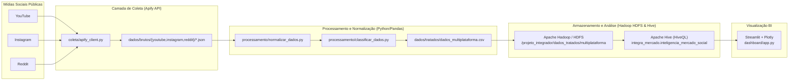

# Sistema Multiplataforma de Inteligência de Mercado — Integra Engenharia de Sistemas

**Instituição:** Pontifícia Universidade Católica de Goiás (PUC Goiás)  
**Curso:** Big Data e Inteligência Artificial  
**Disciplina:** Projeto Integrador V – B  
**Organização Parceira:** Integra Engenharia de Sistemas  

---

## 1. Apresentação do Projeto

Este repositório contém a solução computacional desenvolvida para a disciplina **Projeto Integrador V – B** do curso de Big Data e Inteligência Artificial da PUC Goiás. O sistema realiza a coleta, normalização, classificação heurística exploratória, armazenamento distribuído em **Apache Hadoop (HDFS)**, análise estruturada em **Apache Hive (HiveQL)** e visualização executiva em **Streamlit e Plotly** a partir de dados públicos provenientes de três plataformas de mídias sociais: **YouTube**, **Instagram** e **Reddit**.

---

## 2. Contextualização da Integra Engenharia de Sistemas

A **Integra Engenharia de Sistemas** atua no desenvolvimento, implantação, manutenção e suporte técnico de soluções tecnológicas e softwares de gestão empresarial (ERP). Suas operações abrangem:
- Desenvolvimento evolutivo e manutenção de sistemas corporativos;
- Implantação de softwares e parametrização de processos;
- Suporte técnico e atendimento a chamados operacionais;
- Treinamento de usuários e clientes.

Em etapa acadêmica anterior, foi construído um dashboard executivo interno focado em SLA, Lead Time, produtividade e chamados (utilizando Firebird, Pandas, Streamlit e Plotly). Este novo projeto complementa a visão interna com **inteligência de mercado externa**, capturando percepções públicas sobre softwares de gestão empresarial.

---

## 3. Problema Investigado

Como usuários, gestores e profissionais discutem softwares de gestão empresarial, sistemas ERP, processos de implantação, suporte técnico e automação de processos em diferentes mídias sociais?

> **Nota Importante de Conformidade e Escopo:**  
> Os registros coletados representam uma **amostra exploratória pública do mercado de tecnologia empresarial**, e **não** devem ser atribuídos diretamente à Integra Engenharia de Sistemas ou aos seus clientes.

---

## 4. Objetivos

### Objetivo Geral
Desenvolver uma arquitetura de Big Data capaz de coletar, tratar, armazenar no HDFS, consultar via Apache Hive e visualizar dados públicos de YouTube, Instagram e Reddit para identificar dores recorrentes do mercado de ERP, expectativas de suporte e oportunidades de melhoria.

### Objetivos Específicos
1. Integrar a coleta multiplataforma por meio da API oficial do **Apify** com configurações independentes por Actor;
2. Padronizar e consolidar esquemas heterogêneos em um modelo analítico unificado com **Pandas**;
3. Aplicar classificação heurística exploratória de sentimentos e categorias temáticas;
4. Armazenar os arquivos brutos e tratados no **Apache Hadoop / HDFS** via Docker Compose;
5. Executar consultas analíticas em **HiveQL** sobre tabela externa no **Apache Hive**;
6. Disponibilizar um dashboard executivo interativo com **Streamlit** e **Plotly**.

---

## 5. Tecnologias Utilizadas

| Camada | Tecnologia | Finalidade |
|---|---|---|
| Fontes de Dados | YouTube, Instagram, Reddit | Discussões públicas sobre sistemas ERP e gestão |
| Coleta Multiplataforma | Apify REST API v2 | Execução padronizada e autorizada de Actors públicos |
| Linguagem & Tratamento | Python 3.11+ / Pandas | Orquestração, limpeza, deduplicação e classificação |
| Armazenamento Big Data | Apache Hadoop / HDFS | Armazenamento de dados brutos e tratados na estrutura `/projeto_integrador` |
| Análise SQL em Big Data | Apache Hive / HiveQL | Tabela externa sobre o HDFS e consultas analíticas |
| Visualização Executiva | Streamlit / Plotly | Dashboard interativo de Business Intelligence em 3 abas |
| Configuração | python-dotenv | Gestão segura de variáveis de ambiente e credenciais |

---

## 6. Arquitetura da Solução



---

## 7. Configuração do Apify

1. Crie uma conta gratuita em [https://apify.com](https://apify.com) (o plano gratuito disponibiliza US\$ 5 mensais em créditos de plataforma, suficientes para execuções controladas deste protótipo acadêmico).
2. No painel do Apify, acesse **Settings → Integrations** e copie seu **Personal API Token**.
3. Na raiz do projeto, copie o arquivo `.env.example` para `.env`:
   ```bash
   cp .env.example .env
   ```
4. Preencha a variável `APIFY_API_TOKEN` dentro do arquivo `.env` (nunca versione o arquivo `.env`).

---

## 8. Configuração das Plataformas e Actors Verificados

Cada plataforma utiliza um Actor específico verificado na Apify Store, com seu respectivo template JSON em `config/actors/`:

| Plataforma | Actor ID Oficial | Arquivo de Configuração | Capacidades |
|---|---|---|---|
| **YouTube** | `streamers/youtube-scraper` (e `streamers/youtube-comments-scraper`) | `config/actors/youtube.json` | Pesquisa vídeos por `searchQueries` e coleta metadados e comentários públicos |
| **Instagram** | `apify/instagram-scraper` | `config/actors/instagram.json` | Pesquisa publicações públicas por termo/hashtag (`search`) e extrai legendas e métricas |
| **Reddit** | `trudax/reddit-scraper-lite` | `config/actors/reddit.json` | Pesquisa publicações e comentários públicos em conjunto via `searches` |

### Palavras-chave iniciais configuradas
- `Sistema ERP`
- `Software de gestão empresarial`
- `Implantação de ERP`
- `Suporte técnico de sistemas`
- `Dificuldades com ERP`
- `Automação empresarial`

As palavras-chave podem ser alteradas na variável `SEARCH_KEYWORDS` no arquivo `.env`.

---

## 9. Instalação das Dependências

```bash
python -m pip install -r requirements.txt
```

---

## 10. Execução da Coleta

Para validar a configuração antes da coleta:
```bash
python main.py --validar
```

Para executar a coleta nas três plataformas via Apify:
```bash
python main.py --coleta
```
- Os arquivos brutos são salvos automaticamente em `dados/brutos/youtube/`, `dados/brutos/instagram/` e `dados/brutos/reddit/` no formato JSON, preservando os atributos originais e metadados de auditoria (`_coleta_meta`).
- Caso uma plataforma apresente erro de rede ou limite de créditos, o coletor registra a ocorrência em `logs/pipeline.log` e prossegue normalmente com as demais plataformas.

---

## 11. Tratamento, Normalização e Classificação Heurística

Para processar os arquivos JSON brutos e gerar o CSV consolidado:
```bash
python main.py --tratamento
```
- Gera `dados/tratados/dados_multiplataforma.csv` (em `UTF-8-SIG` para leitura direta em planilhas) e `dados/tratados/dados_multiplataforma_hive.csv` (em `UTF-8` sem BOM para ingestão no HDFS/Hive).
- **Regras aplicadas:**
  - Padronização de datas em ISO 8601 UTC (`YYYY-MM-DDTHH:MM:SSZ`);
  - Preservação de valores nulos (`None` / `<NA>`) para métricas inexistentes na plataforma (sem substituir nulos por zero);
  - Remoção de duplicidades pela chave composta `(plataforma, tipo_registro, id_registro)`;
  - Pseudonimização de menções (`@[USUARIO]`) e e-mails (`[EMAIL_OMITIDO]`) em conformidade com a LGPD;
  - **Metodologia de classificação:** Classificação **heurística exploratória baseada em palavras-chave** para sentimentos (`Positivo`, `Negativo`, `Neutro`) e temas (`Atendimento e suporte`, `Implantação`, `Preço e custo`, `Funcionalidades`, `Desempenho e lentidão`, `Integração e automação`, `Outros`).

---

## 12. Configuração do Ambiente Apache Hadoop / HDFS

O módulo `hadoop/scripts/enviar_hdfs.py` opera diretamente sem necessidade de Docker:
- Caso o cliente nativo `hdfs` esteja instalado no `PATH` do sistema operacional (`HADOOP_HOME`), utiliza os comandos nativos `hdfs dfs`.
- Caso contrário, opera em **modo HDFS Standalone Local** (`hadoop/hdfs_storage/projeto_integrador`), preservando exatamente a hierarquia lógica `/projeto_integrador/...` para execução acadêmica local.

---

## 13. Armazenamento no HDFS

Com o CSV tratado gerado, envie os arquivos reais para a estrutura do HDFS:

```bash
python main.py --hdfs
```

O script `hadoop/scripts/enviar_hdfs.py` cria e popula a seguinte estrutura no HDFS:
```text
/projeto_integrador/
    /dados_brutos/
        /youtube/
        /instagram/
        /reddit/
    /dados_tratados/
        /multiplataforma/dados_multiplataforma.csv
```

---

## 14. Consultas Analíticas em HiveQL (Apache Hive)

Para criar a tabela externa `integra_mercado.inteligencia_mercado_social` apontando para o diretório do HDFS e executar todas as consultas analíticas:

```bash
python main.py --hive
```

Os arquivos HiveQL estão organizados em:
- `hive/criar_tabela.hql`: DDL da tabela externa com `OpenCSVSerde` sobre `/projeto_integrador/dados_tratados/multiplataforma`.
- `hive/consultas.hql`: Contém **10 consultas executáveis em HiveQL** (as 5 obrigatórias + 5 adicionais):
  1. Distribuição de registros por plataforma;
  2. Distribuição de sentimentos;
  3. Assuntos mais recorrentes;
  4. Engajamento por plataforma (respeitando diferenças semânticas entre redes);
  5. Evolução temporal dos registros;
  6. Principais palavras-chave pesquisadas;
  7. Distribuição dos assuntos por plataforma;
  8. Frequência de problemas relacionados a suporte;
  9. Frequência de problemas relacionados à implantação;
  10. Top registros com maior quantidade de curtidas ou votos por plataforma.

---

## 15. Execução do Dashboard (Streamlit e Plotly)

O dashboard pode ser iniciado a qualquer momento, reutilizando os dados já coletados e tratados sem exigir nova coleta:

```bash
streamlit run dashboard/app.py
```

### Estrutura das Abas:
- **ABA 1 — Visão Geral:** 6 indicadores executivos (KPIs) e gráficos de distribuição por plataforma, sentimento e palavra-chave.
- **ABA 2 — Análise de Mercado:** Temas mais recorrentes, principais dificuldades relatadas (foco em relatos negativos), distribuição de assuntos por plataforma, evolução temporal e painel comparativo de engajamento separado por rede.
- **ABA 3 — Detalhamento e Auditoria:** Tabela interativa filtrável por plataforma, palavra-chave, assunto, sentimento e período, com exportação em CSV e inspeção das queries HiveQL.

---

## 16. Testes e Validação

Para executar a suíte completa de testes unitários (19 testes cobrindo configuração, coletores Apify, normalização de YouTube/Instagram/Reddit, tratamento de nulos, deduplicação, classificação heurística, estrutura HDFS/HiveQL e filtros do dashboard):

```bash
python tests/run_all_tests.py
```
Ou utilizando `pytest`:
```bash
pytest -v
```

---

## 17. Limitações Conhecidas

1. **Classificação Heurística Exploratória:** O classificador de sentimentos e assuntos baseia-se em regras léxicas de palavras-chave, podendo não capturar ironias, sarcasmos ou contextos ambíguos. Os resultados não devem ser interpretados como sentimentos comprovados estatisticamente.
2. **Amostra Não Representativa da Empresa:** Os dados refletem discussões públicas gerais sobre sistemas ERP nas redes sociais, não representando clientes da Integra Engenharia de Sistemas.
3. **Cotas e Restrições de Plataformas:** A coleta no Apify está sujeita aos limites de créditos gratuitos da conta (`APIFY_API_TOKEN`) e às políticas anti-bot de plataformas como o Instagram, motivo pelo qual o pipeline possui isolamento de falhas por plataforma.
4. **Incompatibilidade de Métricas entre Redes:** Curtidas no YouTube/Instagram, upvotes no Reddit e visualizações de vídeo possuem mecânicas distintas e não devem ser somados ou comparados diretamente como uma métrica única.
